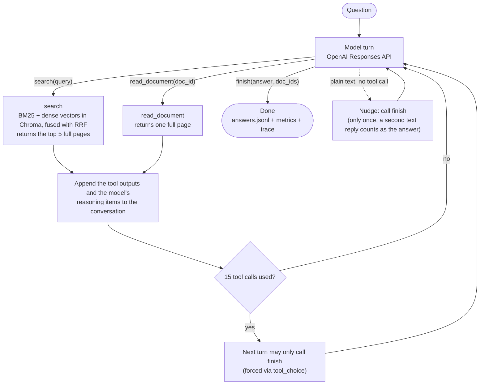

# organizing-knowledge-for-agents

Experiments on how data structure (metadata, progressive disclosure, folder layout) affects agentic retrieval, using the Confluence slice of [EnterpriseRAG-Bench](https://github.com/onyx-dot-app/EnterpriseRAG-Bench).

The baseline is an agent built on the OpenAI Responses API. Its search tool does hybrid retrieval: OpenAI `text-embedding-3-large` vectors in Chroma plus in-memory BM25, fused with reciprocal rank fusion. Every grid cell runs the same agent loop; conditions differ only in config toggles for the tools and the indexed text.

Goals, experiment grid, decision log and current status: [docs/embed-and-basic-agent-loop.md](docs/embed-and-basic-agent-loop.md).

## How the agent works

A deliberately minimal harness: one model, three tools, a fixed tool budget.



- **One request per turn.** The model can call several tools in parallel within a turn, and each call is run and answered separately.
- **The conversation only grows.** Tool outputs are appended, and so are the model's reasoning items (encrypted, since requests use `store=False`). A reasoning model therefore keeps its train of thought across tool calls.
- **The budget is enforced per call.** If parallel calls would exceed it, the extra calls get a "budget exhausted" reply instead of running. Set the budget with `agent.max_tool_calls`.
- **Where the code lives:**
  - `agent.py`: the loop
  - `tools.py`: tool definitions and how results are rendered
  - `search.py`: hybrid search

## Setup

Requires [uv](https://docs.astral.sh/uv/), which also installs the pinned Python 3.14 if needed.

```bash
uv sync
cp .env.example .env   # fill in OPENAI_API_KEY (and OPENAI_BASE_URL for a company endpoint)
```

The Confluence corpus is committed under `data/confluence/`. The questions and the evaluator come from an EnterpriseRAG-Bench checkout, expected at `../EnterpriseRAG-Bench`. Set `ERB_ROOT` if it lives elsewhere:

```bash
git clone https://github.com/onyx-dot-app/EnterpriseRAG-Bench.git ../EnterpriseRAG-Bench
```

## 1. Build the index (once per text variant)

```bash
uv run python -m organizing_knowledge_for_agents.index            # text-embedding-3-large, variant m0 (title + content)
```

This embeds 5,189 docs (about 11.5M tokens) into `data/chroma/`. If it's interrupted, re-running the same command resumes.

Embeddings use the same OpenAI endpoint and key as the agent, unless `EMBED_BASE_URL` / `EMBED_API_KEY` are set:
- On Azure, set `EMBED_MODEL` to the deployment name.
- The longest page is about 6,600 tokens, under the model's 8,191-token input limit, so nothing is truncated.
- `text-embedding-3-large` is also what EnterpriseRAG-Bench's own vector baseline uses, so dense-retrieval results are comparable.

## 2. Run the agent

```bash
# pilot first: measure cost per question before committing to the grid
uv run python -m organizing_knowledge_for_agents.run --config configs/baseline.toml --questions confluence --limit 10

uv run python -m organizing_knowledge_for_agents.run --config configs/baseline.toml --questions confluence --repeat 0
uv run python -m organizing_knowledge_for_agents.run --config configs/baseline.toml --questions not_found  --repeat 0
uv run python -m organizing_knowledge_for_agents.run --config configs/baseline.toml --questions metadata   --repeat 0
```

| Question set | Source | Count | Evaluate with |
|---|---|---|---|
| `confluence` | `questions.jsonl`, `source_types == ["confluence"]` | 64 | `questions.jsonl` |
| `not_found` | `questions.jsonl`, `info_not_found` (abstention control) | 20 | `questions.jsonl` |
| `metadata` | `extra_questions.jsonl`, Confluence only | 12 | `extra_questions.jsonl` (IDs overlap with the main file) |

Output goes to `runs/<config>/<model>/<question set>/r<repeat>/`:

- `answers.jsonl`: the evaluator's input format.
- `metrics.jsonl`: tokens, cached tokens, tool calls, docs seen and latency per question.
- `summary.json`: aggregates over the run.
- `traces/`: full agent transcripts, minus encrypted reasoning.

Runs resume, and questions that errored are retried on the next invocation. Agent runs are nondeterministic, so repeat each cell (`--repeat 1`, `--repeat 2`, ...). `runs/` is gitignored because it contains benchmark questions and answers.

## 3. Evaluate

The evaluator lives in the bench repo and needs its dependencies. Pin one judge model for the whole study. Don't use the small agent model as the judge.

```bash
set -a; source .env; set +a   # export OPENAI_API_KEY (and OPENAI_BASE_URL) for the evaluator
cd ../EnterpriseRAG-Bench
RUN=../organizing-knowledge-for-agents/runs/baseline/gpt-5-mini/confluence/r0
LLM_PROVIDER=openai LLM_API_KEY=$OPENAI_API_KEY LLM_MODEL_NAME=<judge model> \
uv run --no-project --with-requirements requirements.txt \
  python -m src.scripts.answer_evaluation.metrics_based_eval \
    --answers-file $RUN/answers.jsonl \
    --questions-file questions.jsonl \
    --results-file $RUN/results.json \
    --updated-questions-file $RUN/questions_updated.jsonl \
    --no-correction --parallelism 8
```

`--no-correction` keeps the gold set fixed. Without it, the evaluator can rewrite gold docs and answer facts based on what each run retrieved, so different cells would be scored against different ground truths. The evaluator doesn't read this repo's `.env`, which is why the first line exports it. That also passes on `OPENAI_BASE_URL`, so the judge runs against your company endpoint too. For the `metadata` set, use `--questions-file extra_questions.jsonl`.

## Layout

```
src/organizing_knowledge_for_agents/
  settings.py   paths, env, experiment config (TOML -> dataclasses)
  corpus.py     load + clean docs (whitelisted metadata only), text variants
  questions.py  question sets
  embeddings.py OpenAI embeddings client (text-embedding-3-large)
  index.py      embeddings -> Chroma indexing (resumable)
  search.py     hybrid search (dense + BM25, RRF)
  tools.py      agent tools and their rendering; grid toggles live here
  agent.py      Responses API loop with tool budget and forced finish
  run.py        runner: parallel, resumable, writes answers/metrics/traces
configs/        one TOML per grid cell
data/confluence the corpus (raw EnterpriseRAG-Bench JSON)
tests/          loop tests (fake client) + corpus checks (no API keys needed)
```

## Adding a grid condition

1. Copy `configs/baseline.toml` and give it a unique `name`.
2. Change one dimension:
   - **Progressive disclosure:** `tools.result_view = "preview"`. Search then returns previews, and the agent must call `read_document`.
   - **Metadata visible:** `tools.show_metadata = true`.
   - **New indexed text** (e.g. metadata in the embedding): add a variant in `corpus.render_text`, index it with `--variant`, and set `retrieval.text_variant`.
   - **New tools** (folder navigation, metadata filters, outlines): add them in `tools.py` behind a `ToolsConfig` flag.

The raw JSON in `data/confluence/` contains generator artifacts. `original_location` is the pre-noise folder of a misfiled doc, and `dataset_noise_document` marks noise docs. `corpus.load_docs` keeps only whitelisted metadata fields, so neither reaches the agent. Keep it that way, unless a condition deliberately uses `original_location` as an oracle.

```bash
uv run pytest            # no API keys needed; corpus/question checks need the data and the bench checkout
```
